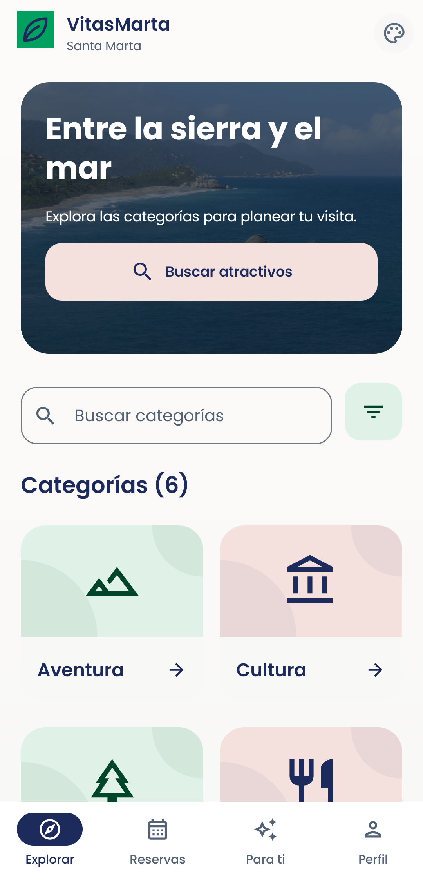
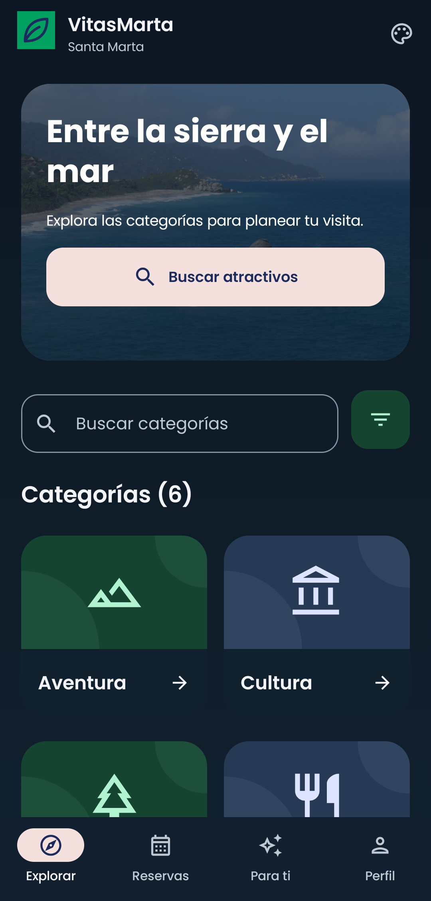
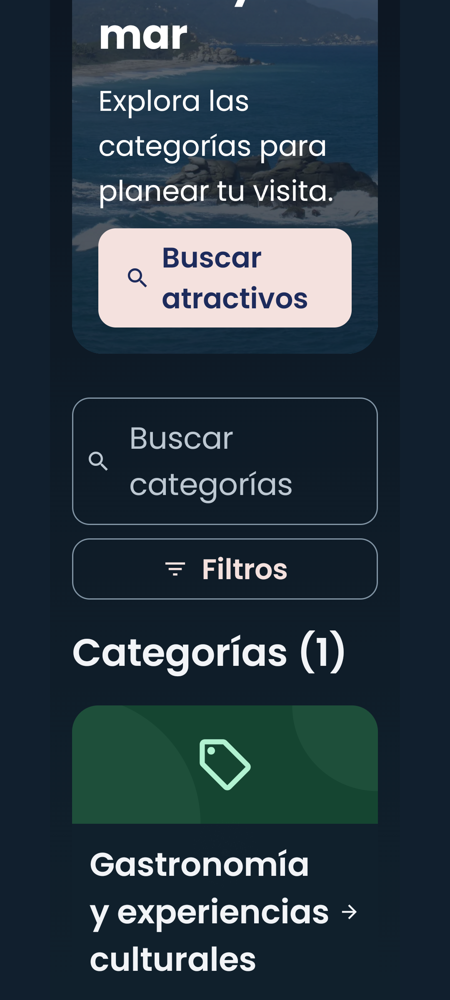

# Explorar fotográfico — plan antes del código

## Dirección

Santa Marta entra por su paisaje: ensenadas de Tayrona en una cabecera con
fotografía local, título blanco y búsqueda visible. Alrededor, composición
tranquila y alineada a la izquierda. Se conservan Poppins y el sistema nativo:
tinta #1D2B5C, verde #006B3F, rosa #F4E1DE, base #FDFBFA, noche #0D1723,
texto oscuro #F2F4F7. Los fondos toman los contenedores del tema existente.

Esquema: marca → fotografía/título/buscar → categorías/filtro → cuadrícula →
créditos. Hero de altura mínima, crece con el texto; tarjetas de altura mínima,
sin truncar nombres. Una columna en ancho estrecho o fuente grande, dos en móvil
y tres en ancho amplio; contenido limitado a 1120dp. Desplazamiento vertical único.

## Crítica del plan

Se descarta colocar fotografías detrás de todos los formularios: compiten con
la lectura. La cabecera concentra el protagonismo. Para no repetir una misma
foto en seis categorías, Playa/Naturaleza usan fotografía y las demás usan
arte vectorial nativo específico (montaña, patrimonio, bosque, gastronomía).
Son ilustraciones editoriales, no resultados ni ofertas inventados. Solo las
categorías recibidas del Gateway se dibujan y conservan su acción real.

## Skills aplicadas

frontend-design 1.1.1 y modern-web-guidance 1.0.1 leídas. Guías completas
deliver-optimized-decorative-images y color. En Compose, imágenes WebP locales
con tamaño acotado y painterResource: no hay descubrimiento tardío por CSS/red.
La portada usa fondo fotográfico con capa oscura mínima 62%, y texto blanco
sobre esa pareja fija; controles usan pares del tema. Regla: «Maintain 4.5:1
for normal text». Decoración con contentDescription=null; nombres y acciones
conservan texto accesible. No se introduce HTML, CSS ni WebView.

## Fuentes de imagen

- Tayrona: Felipe Restrepo Acosta, CC BY-SA 4.0, Wikimedia Commons.
- Santa Marta Bahia: Petruss, dominio público, Wikimedia Commons.

Assets derivados: reducción y compresión WebP sin retocar el contenido; crédito
y enlaces de fuente/licencia accesibles en pantalla y licencia incluida en assets.
Pruebas previstas: build/JVM/lint/ktlint; navegación existente, claro/oscuro y
maquetación estrecha con fuente al 200% mediante pruebas de UI sin mutaciones.

## Revisión y verificación final

La primera revisión de capturas detectó decoración que invadía el pie de tarjeta
y campo de búsqueda demasiado estrecho al200%. Se añadió clipToBounds al arte
y controles apilados en ancho/fuente grande; no se redujo el tamaño de la letra.
Se ajustó la capa oscura a .62–.76: contraste mínimo5.07:1 incluso sobre una
foto completamente blanca. El botón usa rosa/tinta del sistema de marca.

verify-android.sh BUILD SUCCESSFUL: 104 JVM, cero fallos/errores/omitidas; lint
sin errores/advertencias y ktlint aprobado. Runner físico: 12 casos,11 aprobados,
1 omitido por requerir Gateway vacío, cero fallos. Se repitió tras los ajustes.
Nueva prueba a320dp y fuente200%: nombre largo completo, scroll y callback real
de selección. Fixture exclusivamente en androidTest. También pasó categoría real
→ búsqueda, contenido publicado → ficha → acceso de reserva, claro/oscuro.
No se crearon reservas ni se modificaron perfiles.

Fotos locales y créditos: [licencias](../licenses/EXPLORE_IMAGES.md). Peso conjunto
132KB; no requieren red, no contienen datos de ofertas ni cambian los endpoints.
Es un rediseño de Explorar; la adaptación a múltiples tablets/orientaciones y
la auditoría TalkBack completa no se dan por verificadas con estas capturas.
