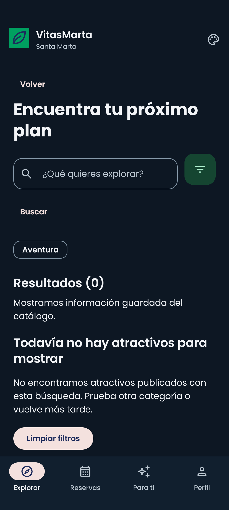
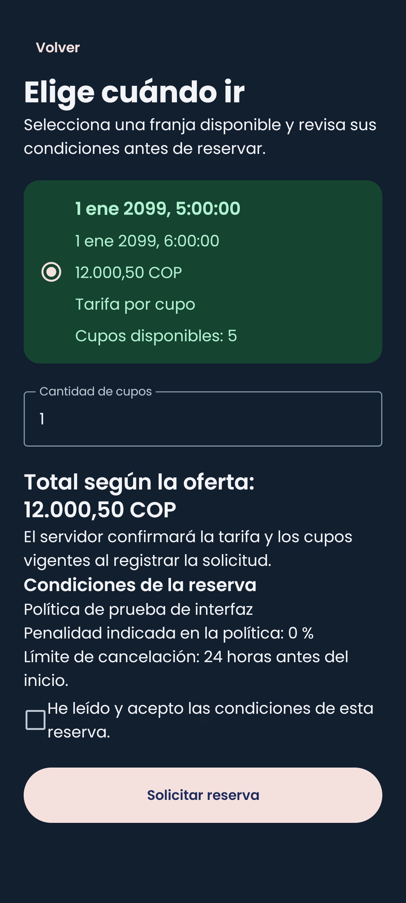

# Verificación física del flujo turista — 2026-11-18

Xiaomi 2201122G, Android15. connectedDebugAndroidTest con gatewaySmoke=true:
diez casos, nueve aprobados, uno omitido, cero fallos/errores. La omisión exige
un build sin Gateway; esta compilación sí tiene origen real. No se hicieron
mutaciones sobre cuentas o reservas reales.

Se verificaron acceso/registro sin envío, tema y recreación de Activity, política
HTTP por host, categorías reales, categoría → búsqueda → Atrás y guards privados.
Dos pruebas adicionales montan las pantallas reales con estados sintéticos SOLO
en androidTest para revisar política/aceptación y recomendación degradada vacía.
La primera revisión detectó falta de Surface en esos dos harness de UI; se añadió
el contenedor del tema y se repitió toda la suite, nuevamente sin fallos.

Esta captura es una consulta filtrada; no significa que el catálogo general esté
vacío. La revisión posterior encontró tres contenidos públicos: ver
[revisión del despliegue](../specs/REPOSITORY_RECHECK_2026-11-18.md).

Datos de oferta, fecha 2099 e importe son un fixture de androidTest. No se ofrece
este contenido en producción ni se generó una reserva real.

La pantalla conserva contenido/avisos de degradación y vacío como estados distintos
de error. Es un fixture visual; no una recomendación personalizada del despliegue.
Capturas revisadas: títulos, política, casilla y acciones legibles con fondo oscuro;
contenido desplazable. No sustituye TalkBack, texto al 200% o múltiples dispositivos.

Nueva prueba del catálogo publicado compilada después: pendiente de ejecución
porque el teléfono se desconectó. No se declara el recorrido físico de ficha/oferta
aprobado hasta ejecutar esa prueba.
