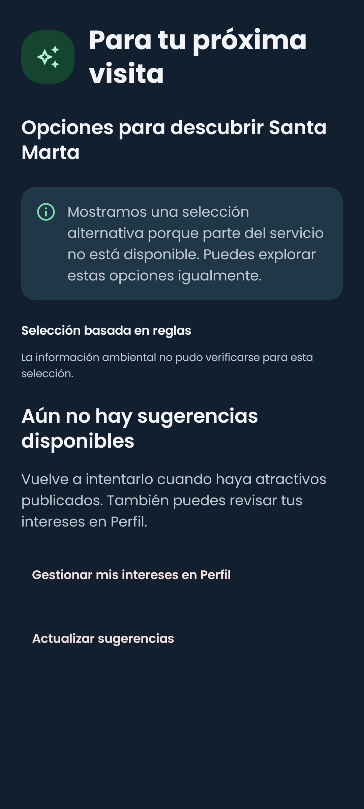
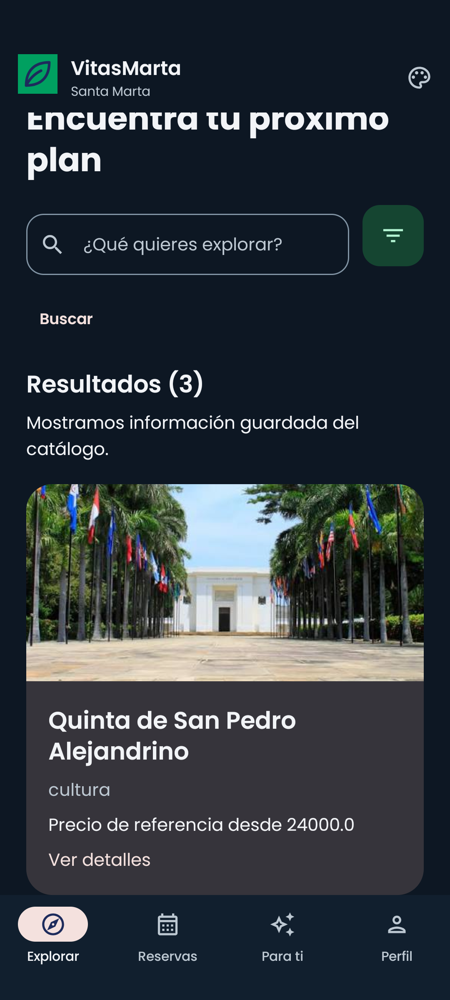
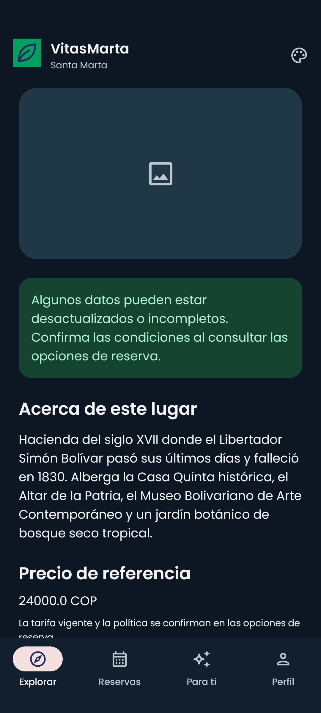

# Verificación física del flujo turista — 2026-11-18

Xiaomi 2201122G, Android15. connectedDebugAndroidTest con gatewaySmoke=true:
Corte previo: diez casos, nueve aprobados, uno omitido, cero fallos/errores. La omisión exige
un build sin Gateway; esta compilación sí tiene origen real. No se hicieron
mutaciones sobre cuentas o reservas reales.

Se verificaron acceso/registro sin envío, tema y recreación de Activity, política
HTTP por host, categorías reales, categoría → búsqueda → Atrás y guards privados.
Dos pruebas adicionales montan las pantallas reales con estados sintéticos SOLO
en androidTest para revisar política/aceptación y recomendación degradada vacía.
La primera revisión detectó falta de Surface en esos dos harness de UI; se añadió
el contenedor del tema y se repitió toda la suite, nuevamente sin fallos.

Esta captura es una consulta filtrada; no significa que el catálogo general esté
vacío. La revisión posterior encontró tres contenidos públicos: ver
[revisión del despliegue](../specs/REPOSITORY_RECHECK_2026-11-18.md).

Datos de oferta, fecha 2099 e importe son un fixture de androidTest. No se ofrece
este contenido en producción ni se generó una reserva real.

La pantalla conserva contenido/avisos de degradación y vacío como estados distintos
de error. Es un fixture visual; no una recomendación personalizada del despliegue.
Capturas revisadas: títulos, política, casilla y acciones legibles con fondo oscuro;
contenido desplazable. No sustituye TalkBack, texto al 200% o múltiples dispositivos.

Nueva prueba del catálogo publicado compilada después: pendiente de ejecución
porque el teléfono se desconectó. No se declara el recorrido físico de ficha/oferta
aprobado hasta ejecutar esa prueba.

## Catálogo publicado: prueba física final aprobada

Once casos con runner directo: diez aprobados, uno omitido, cero fallos.
El recorrido selecciona un título real recibido por API, abre su ficha, desplaza
la galería para leer la descripción y accede al login contextual de reserva.
La espera y el scroll se ajustaron para elementos LazyColumn aún no compuestos.

Estas dos capturas corresponden al despliegue público real. No acreditan ofertas
M3, inicio de sesión ni una reserva creada. Sustituyen el estado de prueba
pendiente por desconexión registrado más arriba.
