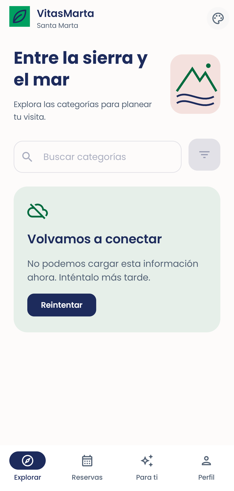
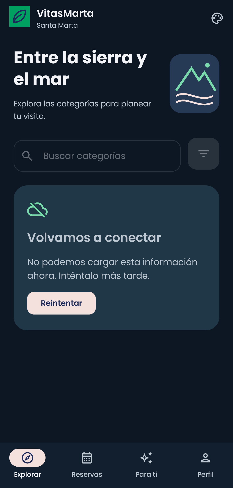

# Dirección nativa y tema oscuro

Solicitud del propietario: diseño móvil moderno con identidad propia y tema oscuro.
Skills releídas/consultadas: frontend-design 1.1.1 y modern-web-guidance 1.0.1.
Guías dark-mode, dark-mode-toggle y color recuperadas completas (539 líneas).

## Plan previo al código

El sujeto es Santa Marta: Caribe y Sierra. La app ayuda al turista a explorar y
organizar su visita. La expresión propia se concentra en una ilustración vectorial
pequeña de mar/sierra y una jerarquía táctil clara, con Poppins de marca. La navegación
se organiza en cuatro destinos nativos; ajustes de apariencia en una hoja modal.

Paleta clara: tinta #1D2B5C, base #FDFBFA, rosa #F4E1DE, verde #006B3F, blanco.
Paleta oscura: fondo #0D1723, superficie #111F2E, superficie elevada #203747,
texto #F2F4F7, acento rosa #F4E1DE, verde #79DBAC. Contraste a verificar en ambos.

Explorar: encabezado compacto, título y marca territorial, búsqueda local de categorías,
filtro explícito de categorías principales, lista real y estado de conexión recuperable.
La búsqueda de experiencias continúa pendiente de contrato completo: el control
presente se denomina “Buscar categorías” y solo filtra datos ya recibidos.

Acceso: encabezado breve, icono contextual, campos con iconos/etiquetas persistentes,
acción principal de 56dp y recuperación secundaria. Apariencia disponible sin login.
Sistema/Claro/Oscuro persiste en DataStore; Sistema elimina la preferencia explícita.
La elección explícita no desaparece cuando el sistema cambia. Splash conserva el
arranque hasta cargar preferencias; barras del sistema siguen el tema efectivo.

## Crítica del plan frente al encargo

La base anterior dependía de títulos grandes y un error suelto. Se reemplaza por
composición completa, estados contenidos, controles táctiles y superficies semánticas.
La particularidad visual procede de la relación sierra/mar, no de gradientes genéricos,
KPI decorativos ni numeración de listados. Se conserva la marca y se rehacen distribución,
navegación y formularios para Android. No se presentan fotos o destinos sintéticos.

## Adaptación de guías

- dark-mode: “apply ... to ... root” se traduce a un único MaterialTheme, splash e
  iconos de barras de sistema coherentes; sin CSS/HTML.
- dark-mode-toggle: “In all cases, the UI MUST support reverting ... to system”:
  hoja de ajustes con Sistema, Claro y Oscuro; preferencia persistente explícita.
- color: “Don't use color alone ... state”: selección de radio con semántica y texto;
  errores con mensajes/íconos; pares texto/superficie comprobados.

La implementación se contrastará mediante compilación, unitarias, lint, formato,
pruebas físicas y capturas reales clara/oscura. Este documento es el plan; el resultado
se registra en IMPLEMENTATION.md después de ejecutar las verificaciones.

## Resultado observado

Build, lint y formato aprobados; 34 pruebas JVM y tres Compose físicas aprobadas.
Se revisaron ambas capturas: títulos y navegación legibles, campos sin desbordamiento,
superficies diferenciadas y estado de conexión con acción de reintento. La distribución
es propia de Android y la ilustración es vectorial nativa; no hay fotos ni destinos ficticios.
La pantalla muestra el estado de conexión real porque falta un origen HTTPS utilizable.
Quedan pendientes validación manual con TalkBack, escalado de fuente y más dispositivos.

| Claro | Oscuro |
|---|---|
|  |  |

## Catálogo real conectado — 2026-11-18

Tras autorizar HTTP, la prueba física cargó seis categorías reales; se revisó la captura
con controles habilitados y lista de datos del Gateway. No cambia la composición ni
la selección de apariencia. [Captura de Explorar conectado](device-explore-connected.png).
La pantalla sin origen de las capturas previas documenta el estado de error histórico.
