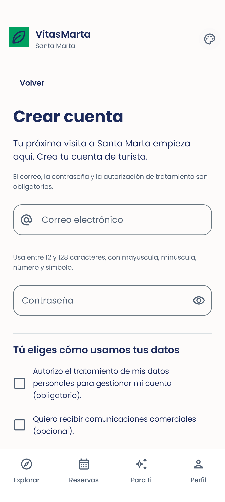
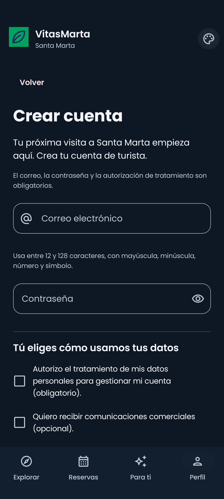

# Registro nativo — plan previo al código

## Contrato confirmado

Gateway G1 expone POST /api/v1/identidad/cuentas como público. La copia de lectura
servicio_identidad queda fijada en 95f1d32c5bebb95ea9fbd864330275b4994e05e1.
CuentaController, RegistroRequest y ConsentimientoRequest confirman correo, password,
tipo_usuario TURISTA y consentimientos [{finalidad,otorgado}]. Jackson usa snake_case.
201 devuelve {mensaje}; no emite sesión. M7 fija versión de política y exige
TRATAMIENTO; COMERCIAL y PERFILADO son independientes y opcionales.
PoliticaPassword exige 12 caracteres, mayúscula/minúscula/número/símbolo no blanco;
RegistroRequest limita a 128. Esto resuelve D03 sin elegir entre textos ambiguos.

## Plan visual y funcional

Se mantienen Poppins y tokens propios: tinta #1D2B5C, rosa #F4E1DE, verde #006B3F,
base #FDFBFA, oscuro #0D1723, texto oscuro #F2F4F7. Formularios alineados a izquierda,
una columna desplazable, márgenes de 24dp, campos y acciones táctiles de 56dp.

Acceso: crear cuenta visible antes de los campos; recuperación permanece después
del botón de acceso. Esto evita esconder el registro debajo del teclado.
Registro: volver, título Crear cuenta, descripción de turista, correo, reglas de
contraseña visibles antes del campo, contraseña con mostrar/ocultar, consentimientos
agrupados, botón Crear cuenta y retorno a acceso. No se pide nombre ni repetir
contraseña porque M7 no los exige; autocompletado NewUsername/NewPassword.

Esquema: [Volver] → Crear cuenta → correo → reglas + contraseña → autorizaciones
→ Crear cuenta. Éxito: Revisa tu correo → instrucciones de confirmación → Iniciar sesión.

## Revisión del plan y guías

No se clona la página web: se mantiene el sistema visual nativo, una sola contraseña
con visor y acceso al registro antes del formulario. No se añaden paneles ni métricas
decorativas. Se conservan los tres consentimientos exactos del contrato, todos
desactivados inicialmente. El tratamiento es obligatorio; los opcionales no bloquean.
Los errores aparecen al enviar y se limpian al editar; foco al primero inválido.

frontend-design 1.1.1 se adapta al sistema de diseño móvil existente.
modern-web-guidance 1.0.1: forms, validate-input-after-interaction y autofill-sign-up-form
leídas completas (984 líneas). Se adaptan etiquetas, validación al enviar, semántica
de autocompletado y controles nativos a Compose. La instrucción HTTP del propietario
prevalece sobre la recomendación HTTPS de la guía; no se cambia el transporte aquí.

## Verificación prevista

MockWebServer: ruta/payload/201/errores y ausencia de autorización; ViewModel: validación,
opcionales, doble envío, borrado de contraseña, error y éxito sin sesión. UI física:
entrada desde acceso, formulario inicialmente sin errores, consentimientos sin marcar,
validación y volver. No se crea cuenta ni se envía correo real de prueba.

## Resultado observado

Compilación, lint, formato y 44 pruebas JVM aprobadas. Seis casos físicos: cinco
aprobados y un caso sin Gateway omitido; cero fallos. La nueva prueba recorre Perfil
→ Crear cuenta, comprueba errores inicialmente ausentes, consentimientos apagados,
independencia de opcionales, errores al enviar vacío y vuelta a acceso. No envía registros.
Se capturó y revisó el mismo formulario en claro y oscuro: lectura, campos y casillas
coherentes con el sistema visual, sin desbordamientos. La pantalla se desplaza para
acceder a PERFILADO, acción Crear cuenta y retorno a acceso.

| Claro | Oscuro |
|---|---|
|  |  |

Esto no certifica TalkBack ni una auditoría multidispositivo. El éxito remoto y la
entrega del correo no se probaron con datos reales; se verificaron contra M7 y MockWebServer.
