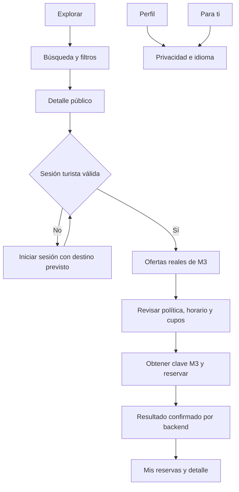

# Matriz móvil de pantallas, roles y contratos

Propuesta Fase 0 del 2026-11-17; turista primero sujeto a confirmación. IDs de API
resuelven a [API_INVENTORY.md](API_INVENTORY.md). Estado vigente: implementados catálogo, búsqueda/ficha, ofertas y gestión de reservas, perfil/idioma/intereses/consentimientos/ARCO y recomendaciones. Identidad avanzada y ensayos remotos privados pendientes.

| Pantalla / destino | Acceso | Endpoints / IDs | Estados y aceptación |
|---|---|---|---|
| Explorar | Visitante | CAT-01/02 | Carga, contenido, vacío con limpiar filtros, error recuperable, sin red, actualización, caché con fecha si existe |
| Búsqueda y filtros | Visitante | CAT-01/02 | Debounce, cancelación anterior, cursor, filtros preservados al ordenar; fecha/precio sin datos inventados |
| Detalle y galería | Visitante | CAT-03/04/05, ENV-01 | Solo atributos presentes; imágenes con error; 204 ambiental omite sección; fallo secundario no rompe contenido |
| Acceso contextual | Visitante → titular | AUTH-01/02/03 | Login en progreso, validación, 401, 423, sin red, destino conservado por id; otro rol no entra al grafo turista |
| Crear cuenta / verificar | Visitante | AUTH-04/05/06 | Registro implementado: D03 resuelta con fuente M7, consentimientos independientes y opcionales desactivados; instrucciones de verificación por correo; App Links y reenvío nativos pendientes |
| Recuperar / restablecer | Visitante | AUTH-07/08 | Respuesta anti-enumeración; token expirado; D04 pendiente; App Links por confirmar |
| Desafío MFA | Rol que lo exige | AUTH-09 | No habilitar sin contrato validado ni abrir área administrativa por defecto |
| OAuth | Visitante | AUTH-10/11 | Bloqueado hasta callback nativo confirmado; sin WebView |
| Elegir horario y cupos | Turista | BOOK-01 | Cupos vivos desde M3, desconocidos explícitos; conflicto reconsulta oferta; política por versión |
| Revisar y reservar | Turista | BOOK-02/03 | Resumen exacto, aceptación explícita, envío único, respuesta ambigua recuperable con misma clave |
| Resultado de reserva | Titular | BOOK-05 | Estado devuelto, vencimiento real, pago externo solo si indicado; pendiente no se anuncia confirmada |
| Mis reservas | Turista titular | BOOK-04 | Activas/pasadas/canceladas, paginación propia M3, vacío/error/sin red; limpieza al cambiar de cuenta |
| Detalle / comprobante | Titular | BOOK-05/08 | Actualización y PDF protegido; referencia ajena rechazada por servidor |
| Cancelar / modificar | Titular según operación | BOOK-02/06/07 y BOOK-01 | Confirmación, motivo, penalidad vigente, conflicto y reintentos idempotentes |
| Para ti (recomendaciones) | Turista | REC-01 | Transparencia IA, 206 degradado, sin perfilado, vacío, error recuperable; acceso a consentimiento |
| Perfil y datos | Titular | PRO-01/02 | Carga, edición, validación de servidor, guardado real; solo nombre_visible; otros datos no se sobrescriben |
| Idioma e intereses | Titular | PRO-03/04/06 | es-CO/en-US, selección persistida localmente; sincronización servidor sin sobrescribir campos al fallar GET |
| Privacidad / consentimientos | Titular | PRO-07/08 | Versiones e historial reales; fallo revierte control; opt-out modifica M7, no llama endpoint inventado M6 |
| Derechos y exportación | Titular | PRO-09/10/11/12 | Seguimiento por pasos reales; PDF; cancelación ARCO no se presenta como borrado inmediato |
| Cerrar sesión | Titular | AUTH-03 | Invalidar estado local y peticiones en vuelo, limpiar datos privados; informar revocación remota fallida si aplica |
| Prestador / administración / monitoreo | Aprobación futura | Inventario pendiente por rol | Sin pantallas añadidas por defecto; guards UI no sustituyen permisos backend |

## Navegación y restauración propuestas

Barra inferior: **Explorar · Reservas · Para ti · Perfil**, siempre con etiqueta.
Explorar es pública. Reservas y Para ti muestran acceso contextual al visitante;
Perfil permite idioma local y ofrece iniciar sesión antes de consultar datos privados.
La adaptación a pantallas anchas usa NavigationRail y contenido con ancho legible.

Guardar consulta/filtros/cursor y destino por identificador cuando sea seguro.
No guardar password, tokens, PDF privado ni desafío MFA en SavedStateHandle.
Recuperar datos privados de servidor al restaurar sesión; respuesta tardía de sesión
anterior no puede repoblar pantalla. Back cierra sheet/teclado, vuelve al paso anterior
y conserva selección no sensible. Un envío en curso no se duplica por rotación.

## Verificación por corte vertical

Cada fila que se implemente necesitará DTO validado, mapper, repositorio de dominio,
ViewModel, Route/Screen, éxito/error y tests deterministas apropiados. MockWebServer
y fixtures solo en test/debug. Antes de avanzar de funcionalidad ejecutar assembleDebug,
testDebugUnitTest, lintDebug y formato; pruebas Compose/instrumentadas cuando exista dispositivo.
Revisión visual: teléfono pequeño/grande, texto al 200%, teclado, TalkBack, navegación atrás
y restauración. 104 JVM aprobadas y build/lint/formato verificados por corte. Diez pruebas físicas aprobadas y una omitida; ficha publicada y acceso contextual aprobados; TalkBack/texto al 200% y múltiples tamaños siguen pendientes.

## Precisiones del contrato implementado

No se utiliza GET intereses (PRO-05) ni GET alternativas (REC-02), sin handler
en las fuentes auditadas. Intereses se reemplaza explícitamente; alternativas
provienen de alternativas_sugeridas de M6. El perfil solo edita nombre_visible.
Idioma se aplica después del PUT confirmado. Exportaciones/comprobantes usan
selector nativo con bytes privados en memoria; no guardan credenciales o PDF en
SavedStateHandle. No se guardan pilas de navegación con datos de cuentas anteriores.
